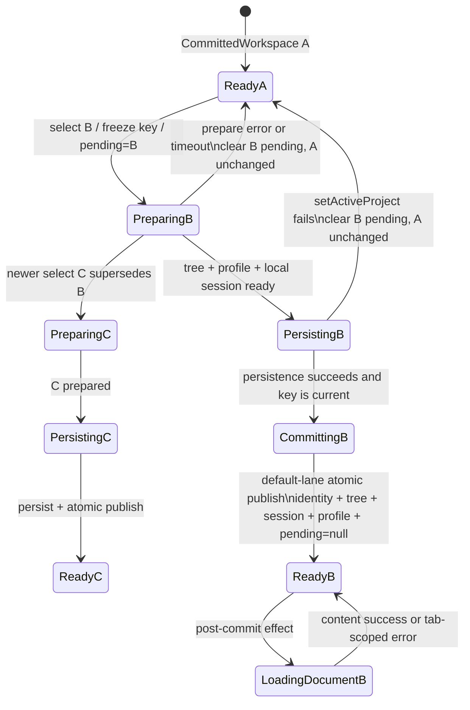

# 2026-08-23 18:39 项目切换提交边界修复设计

- 状态：`ready`
- 设计深度：轻量架构设计；修复集中在 `App` 的项目切换事务与 React 发布时序，不引入新服务、持久化格式或通用框架。
- 开放决策：无。现有 truth、已实施方案与当前代码已经足以确定 owner、失败语义和最小修复路径。

## 方案概述

本次修复要解决的是：用户选择目标项目后，下拉框和本地注册表已经指向目标项目，但页面仍长期显示“正在切换到 God Land…正在准备文件树和文档状态”，左侧文件列表仍未发布目标项目内容。

问题不在文件树缓存协议或 God Land 当前数据本身，而在前端项目切换事务的提交边界。当前实现先成功持久化服务端活动项目，然后把 `activeProjectId`、`pendingProjectId`、文件树和 session 一起放入低优先级 `startTransition()`；该 transition 尚未成为已提交 UI 时，函数已经返回成功并立即触发高优先级的活动文档加载。这样既让“切换完成”的唯一可见信号 `pendingProjectId = null` 可以被延迟，也违反了项目既有的“先同步目标 session，再进入文档加载”顺序不变量。

推荐修复保持现有 `App` 为唯一应用协调 owner：目标 workspace 准备完成且服务端 `setActiveProject()` 成功后，在默认优先级的同一 React 批次中发布目标项目身份、文件树、entry 投影、session、Profile 导航投影和 `pendingProjectId = null`；活动文档加载改为该批次提交后的独立效果，并继续受同一个 `projectId + profileId + revision` 守卫。`startTransition()` 不再承载项目身份、写入 authority 或切换完成信号。

整体执行顺序为：

1. 冻结目标 `projectId + profileId + revision`，进入 preparing，旧 workspace 保持唯一可写 authority。
2. 并行准备目标 tree、Profile 和 local state；失败时清除本次 pending，旧 workspace 不变。
3. 串行持久化目标 active project；失败时同样保留旧 workspace。
4. 在同一默认优先级批次原子发布目标 workspace，并结束遮罩。
5. React 已提交目标 session 后再加载活动文档；正文失败只影响目标 tab，不把项目切换回滚成旧文件树。

## 问题、范围与非目标

### 问题定义

用户看到的目标项目名来自 `pendingProjectId`，不等于目标 workspace 已提交：`TopBar` 在 pending 期间用它覆盖 `activeProjectId`，而切换遮罩也完全由 `pendingProjectId != null` 驱动。当前代码因此允许出现三份事实不同步：

- 服务端 `%APPDATA%/md-reader/projects.json` 已持久化 God Land；
- 顶部项目选择器显示 God Land；
- 前端仍保留旧 `fileTree` / `session`，且 `pendingProjectId` 未清除。

左侧列表没有切换成功不是独立文件树渲染 bug，而是目标 workspace 发布事务没有形成稳定的完成边界。

### 本轮范围

- 修正 `src/App.tsx` 中 `switchLocalServiceProject()` 的准备、持久化、UI 发布和后续文档加载顺序。
- 明确 `pendingProjectId`、`activeProjectId`、`sessionRef`、React `session`、文件树投影和服务端 active project 的 owner 与不变量。
- 补齐项目切换被文档加载打断、失败、超时、快速连续选择及 Profile supersede 的回归测试。
- 通过真实 `127.0.0.1:8797` 工作区切换验证“目标项目名、左侧文件树、标签/session 和遮罩终态”一致。

### 非目标

- 不改变 `server/project-tree-cache.mjs` 的 fingerprint、snapshot、refreshId、generation 或缓存持久化协议。
- 不改变 Markdown 文件系统、`ProjectTreeSnapshot`、项目 Profile 或 local state 的 authority。
- 不把 God Land、Nocturnel 或任何具体项目规则写进 md-reader；Data Editor 亦不受影响。
- 不借机引入全局状态框架、通用事务框架、路由框架或新单例。
- 不处理大型文件树虚拟化、扫描排除规则和 Profile 文件体积；若修复后仍有独立性能问题，再按既有 P95/long-task 协议评估。
- 不更改项目注册表 schema，不迁移用户数据。

## 现状证据与参考资料

### 已验证项目事实

1. `App` 是项目、会话与加载的应用协调 owner；服务端 `project-registry` 拥有按 Profile 持久化的活动项目。锚点：`docs/08_系统结构.md:24-40`、`docs/06_项目与本地服务.md:21-54`。
2. 现有性能方案已经要求：准备/持久化失败保留旧项目，成功后原子提交目标 `activeProjectId`、Profile、文件树和 session；只有目标树可交互且遮罩移除才算完成。锚点：`docs/方案/2026-08-08-md-reader-项目切换加载性能优化方案.md:217-247`、`:302-309`。
3. 当前 `switchLocalServiceProject()` 在 `workspaceProvider.setActiveProject()` 成功后，把 `setActiveProjectId()`、`setPendingProjectId(null)`、`setFileTree()`、`setTreeEntriesByPath()` 和 `setSession()` 全放入 `startTransition()`，随后立即返回 `true`。锚点：`src/App.tsx:1495-1582`，关键段为 `:1546-1574`。
4. `loadDocumentContent()` 会立即执行默认优先级的 `setIsDocumentLoading(true)`，文档完成后再执行 `setSession()`、`setStatusMessage()` 和 `setIsDocumentLoading(false)`。锚点：`src/App.tsx:2639-2684`、`src/App.tsx:1006-1042`。
5. 既有 truth 明确要求目标 `sessionRef.current` 与 React session 发布完成后，才进入活动文档加载，避免旧 session 覆盖恢复结果。锚点：`.claw/truth/features/md-reader-session-restore-and-missing-document-self-heal-boundary.md:3-19`、`.claw/truth/PROJECT-TRUTH.md:130-138`。
6. 当前实现虽然在 transition 回调中先写 `sessionRef.current`，但 transition 的 React `setSession(prepared.session)` 尚未成为已提交状态，外层就开始 `loadDocumentContent()`；其高优先级 functional `setSession(current => ...)` 仍可能以旧 React session 为基线。这是对上述 truth 顺序的实际破坏。
7. `TopBar` 在 pending 期间显示 `pendingProjectId ?? activeProjectId`；`WorkspaceLayout` 的遮罩由 `isProjectSwitching={pendingProjectId != null}` 决定；`AppShell` 同期清空顶部 tabs，但仍向左栏传入当前 `fileTree`。锚点：`src/app/TopBar.tsx:728-741`、`src/App.tsx:3042-3085`、`src/app/AppShell.tsx:137-188`、`src/app/WorkspaceLayout.tsx:2459-2601`。
8. Git 历史显示 `9cec26f` 把原本 transition 外的 `setActiveProjectId()` / `setStatusMessage()` 移入 transition，并新增 `pendingProjectId` 清理同处 transition；这与故障出现的状态组合一致。证据命令：`git show 9cec26f -- src/App.tsx src/app/AppShell.tsx`。
9. 现有 App 测试只覆盖“延迟 tree 最终 resolve 后出现目标节点”，没有冻结“服务端 active 已成功但活动文档加载仍 pending/立即回写时，目标 workspace 和 pending 必须先完成提交”，也没有覆盖 Profile supersede 后 pending 不得遗留。锚点：`tests/app/app-session-restore.test.tsx:255-350`。

### 2026-08-23 运行态窄范围复核

- `npm run health` 返回 `ok: true`、`mode: local-service`、`port: 8797`。
- `%APPDATA%/md-reader/projects.json` 的 `Lans.activeProjectId` 已是 `god-land-664e62e1`。
- `GET /api/projects/god-land-664e62e1/tree?profileId=Lans&mode=prefer-cache` 在约 18 ms 返回 `ready`，含 13 个 entry；God Land Profile 请求约 10 ms 返回。
- 这些结果证明复核时 bridge、God Land tree 和 Profile 可用，支持把当前修复聚焦到前端发布时序；它们不等同于事发瞬间的浏览器调度 trace，因此“transition 被延迟/打断”仍属于由代码链与症状共同支持的高置信根因推论，而不是已采集 React Profiler 的运行时事实。

### 已执行验证

`npm test -- tests/app/app-session-restore.test.tsx tests/workspace/local-bridge-access.test.ts tests/server/project-tree-cache.test.ts` 当前为 3 个文件、43 项全部通过。该结果说明既有成功路径和缓存协议没有普遍失效，也反向证明当前测试基线尚未捕获本次浏览器发布时序缺口。

### 代码索引说明

已先执行 `claw search` 发现项目切换、Profile、文件树与 session truth；本仓库 `gitnexus status` 显示未建立索引，因此按技能合同降级使用 `rg`、定向读取与 `git blame/show` 建立调用链，没有把其他仓库索引误当作 md-reader 证据。

## 领域模型、术语、不变量与唯一 owner

### 术语与 owner

| 术语 | 含义 | 唯一 owner / 真相源 |
| --- | --- | --- |
| `SwitchIntent` | 用户最近一次想进入的 `{ projectId, profileId, revision }` | `App.workspaceLoadRevisionRef` 与本次调用冻结的 key |
| `PendingProject` | 尚未成为可交互 workspace 的目标项目；只用于意图反馈和写锁 | `App.pendingProjectId`；不是 active authority |
| `PersistedActiveProject` | 刷新/重启后应恢复的按 Profile 活动项目 | `server/project-registry.mjs` 管理的 `%APPDATA%/md-reader/projects.json` |
| `PreparedWorkspace` | 目标 tree snapshot、Profile、reconciled local state、session 和派生文件树的不可见准备结果 | 单次 `switchLocalServiceProject()` 调用的局部值 |
| `CommittedWorkspace` | 当前 UI 与写操作共同消费的项目身份、文件树、session 和 Profile 投影 | `App` 的已提交 React state；`activeProjectId` 是身份键 |
| `ProjectTreeSnapshot` | Markdown 路径/时间的完整只读投影 | `server/project-tree-cache.mjs`；真实 Markdown 仍由文件系统拥有 |
| `PostCommitDocumentLoad` | workspace 已提交后，为其活动 tab 加载正文的可取消请求 | `App`，受同一 SwitchIntent key 守卫 |

服务端 active project 与前端 committed workspace 不是竞争的两份同一业务状态：前者是重启恢复事实，后者是当前浏览器可交互事实。切换事务必须按“准备 → 服务端持久化 → 前端发布”推进，pending 期间旧 committed workspace 仍是唯一写入 authority。

### 不变量

1. `pendingProjectId` 只能表示意图，不能授权保存、节点操作、local state 或 Profile 写入目标项目。
2. 服务端 active project 持久化成功之前，前端不得发布目标 `activeProjectId`；持久化失败时旧 committed workspace 完整不变。
3. 前端发布目标时，`activeProjectId`、`fileTree`、`treeEntriesByPath`、`session`、目标 Profile 导航/布局/外观投影和 `pendingProjectId = null` 必须处于同一默认优先级批次；不能把完成信号与工作区内容拆到不同 lane。
4. `startTransition()`、`useDeferredValue()` 或懒加载状态不得拥有项目身份、写入 authority、revision 终态或遮罩清理。
5. 目标 `sessionRef.current` 与已提交 React session 建立后，才允许执行活动文档加载；文档响应不能以旧 session 为 functional update 基线。
6. 活动文档读取失败不回滚已经成功提交的目标项目/文件树；它只把目标 tab 标记为读取失败，缺失文档继续走既有 missing/self-heal 合同。
7. 准备、持久化、文档成功/失败/`finally` 的每个副作用都必须验证同一冻结 key，而不是在中途再次读取可能已变化的 `activeProfileIdRef.current` 作为请求身份。
8. 新意图 supersede 旧意图时，新意图必须替换或清除旧 pending；旧 revision 既不能提交，也不能清除新 pending。Profile 切换开始时必须显式接管 pending 生命周期。
9. `project-tree-interactive` 只能在目标 identity、目标文件树与 session 已提交、遮罩已移除后的首个 animation frame 记录。

## 技术决策及每项决策的原因

### 决策一：项目 workspace 提交不再使用 `startTransition()`

在 `setActiveProject()` 成功后的 commit 回调中，直接以 React 默认优先级批量更新目标 workspace 和 `pendingProjectId = null`。可提取一个仅位于 `App.tsx` 的 `commitPreparedWorkspace(key, prepared)`，集中同步 `activeProjectIdRef`、`sessionRef` 和相关 state，但不新增跨模块框架。

原因：这些字段决定当前项目身份、可见文件树、session 和写权限，属于 correctness state，不是可以延后且保持旧值的纯展示优化。React 18 会对同一异步回调中的默认优先级更新自动批处理，足以保持单次 UI commit；若大型树仍有性能问题，应优化派生/渲染层，而不是把 completion signal 放入低优先级 lane。

### 决策二：冻结完整 SwitchIntent key

进入切换时一次性捕获 `{ projectId, profileId, revision }`；prepare、tree/Profile/local state 请求、`setActiveProject()`、UI commit、文档加载及所有 catch/finally 都只使用该 key。提供局部 `isCurrentSwitch(key)` 判定。

原因：当前代码 prepare 时和 commit/load 时多次读取 `activeProfileIdRef.current`，Profile 快速切换会让同一事务跨 Profile。冻结 key 可让 latest-wins 真正覆盖所有副作用，而不只覆盖 tree 结果。

### 决策三：活动文档改为 post-commit 阶段

原子发布时登记一个带 key 的 `PostCommitDocumentLoad`；由依赖 committed revision/identity 的 `useEffect` 在 React 已提交后调用 `loadDocumentContent()`。effect 清理或 key 失效时只让迟到响应静默退出，不把 `isDocumentLoading`、status 或 session 写入新 workspace。

原因：直接在 schedule state 后立即调用文档加载，无法证明 React session 已发布。post-commit effect 与既有 session truth 完全一致，也允许文件树先成为可交互状态，不让正文读取阻塞项目切换完成。

### 决策四：完整提交目标 Profile 投影

`PreparedWorkspace.profile` 已经在 commit 前可用。提交函数同步应用至少 `manualNodeOrderByParent`、`favoritePaths`、`expandedFileNodes`、`hiddenPaths`、布局和外观字段，并重置仅属于旧 workspace 的 `showFavoritesOnly`、`showRecentOnly`、`showHiddenItems`。后续现有 effect 可继续做 Profile id 列表补充，但不得在目标项目已显示后长期保留旧项目投影。

原因：若只切 identity/tree/session，左栏隐藏规则、展开态或手工排序仍可能来自旧项目，形成另一种“文件列表没有正确切换”。准备结果应成为一次完整 workspace 投影。

### 决策五：pending 生命周期由最新 workspace 意图独占

项目切换的成功、当前 revision 失败和超时负责结束自己的 pending；新的项目意图替换 pending；Profile 切换在递增 revision 时先接管并清除项目 pending，随后按自己的恢复状态展示。旧 revision 的 catch/finally 不操作当前 pending。

原因：当前 stale revision 直接 `return false`，而 Profile 分支不会清除既有 `pendingProjectId`，理论上可以制造永久遮罩。统一 ownership 可关闭这一旁路，即使它不是本次单次项目点击的主要根因。

### 决策六：服务端和缓存协议保持不变

保留现有 `prefer-cache → 202 refreshId/wait → ready/failed`、串行 `setActiveProject()` 与 60 秒 prepare timeout。

原因：当前运行态 tree/Profile 可用，服务端协议已有完备定向测试；本次症状发生在服务端 active 已持久化后的 UI 发布边界。修改缓存会扩大风险且不能修复 pending 与 session lane 脱节。

## 协作合同：入口、状态变化、事件或投影、失败与重试语义

### 状态与生命周期



### 跨系统时序

```mermaid
sequenceDiagram
    actor User
    participant App as App / SwitchIntent owner
    participant Bridge as workspaceProvider + bridge
    participant Registry as project-registry
    participant React as committed workspace state
    participant Doc as document loader

    User->>App: select target project B
    App->>App: key={B, profile, ++revision}; pending=B
    par prepare tree
        App->>Bridge: getProjectTreeSnapshot(B, profile)
    and prepare profile
        App->>Bridge: getProfile(B, profile)
    and prepare local session
        App->>App: localStateStore.getState(B)
    end
    App->>App: reconcile + build PreparedWorkspace
    App->>Registry: setActiveProject(profile, B)
    Registry-->>App: persisted
    App->>React: default-lane atomic commit PreparedWorkspace + pending=null
    React-->>App: committed revision B
    App->>Doc: post-commit load active document (guarded by key)
    Doc-->>React: target-session-only content/error update
```

### 入口合同

`handleProjectChange(projectId)` 仍是用户入口；dirty tab 先走既有保存/确认门。进入 `switchLocalServiceProject()` 后：

- 输入：已注册 target `projectId` 与当前冻结 `profileId`。
- 前置：bridge 健康；目标项目存在于该 Profile 的项目列表；当前 revision 由本次意图拥有。
- 成功：服务端 active 与前端 committed workspace 都指向同一 key，目标文件树可交互，pending 清空；正文可以仍在目标 tab 内加载。
- 返回值：只有 UI workspace 已发布才返回 `true`；仅 POST 成功或仅 schedule transition 不算成功。

### 失败与重试

| 失败点 | UI/持久化结果 | 重试语义 |
| --- | --- | --- |
| bridge health 失败 | 不进入 pending；旧 workspace 保持 | 服务恢复后重新选择 |
| tree/Profile/local state 准备失败或 60 秒超时 | 当前 revision 清 pending，服务端 active 不变，旧 workspace 可继续写 | 用户重试；迟到准备结果不得提交 |
| `setActiveProject()` 失败 | 清 pending，旧 committed workspace 保持；服务端按请求失败事实处理 | 用户重试；队列继续可用 |
| UI key 在 commit 前过期 | 静默放弃旧结果；pending 由新意图拥有 | 无需重试旧请求 |
| post-commit 文档读取失败 | 目标 workspace 不回滚；目标 tab 显示读取错误或走 missing 自愈 | 文档级刷新/自愈，不重新切项目 |
| post-commit 文档响应过期 | 不写 session/status/loading | 新 workspace 自己负责加载 |

## 备选方案、取舍与重新评估条件

### 采用：默认优先级原子提交 + post-commit 文档加载

- 收益：直接恢复既有 session 顺序不变量；完成信号和文件树不再跨 lane；修改集中在 `App.tsx` 与 App 测试。
- 代价：大型目标树的初次 React commit 不再享受 transition 的可中断渲染；但现有目标要求文件树在热路径 P95 300 ms 内真实可交互，不能用长期遮罩伪装完成。
- 重新评估：若修复后真实 Nocturnel 文件树 commit 仍出现超过 100 ms long task 或 P95 超标，应在 `WorkspaceSidebarPane` 评估虚拟化/分段渲染，并确保 committed identity 与 pending completion 仍不进入 transition。

### 未采用：只把 `setPendingProjectId(null)` 移出 transition

- 收益：改动最小，遮罩能快速消失。
- 问题：会短暂或长期显示“目标项目身份 + 旧项目文件树/session”，直接违反原子切换与写入 authority；用户当前已经明确指出左侧列表才是实际失败，因此不能只修文案。

### 未采用：继续使用 transition，但用 `flushSync()` 强制清理

- 收益：可以强制某次 DOM commit。
- 问题：把业务事务依赖到渲染强刷，容易造成嵌套更新和性能退化；仍不能自然解决 post-commit 文档加载与旧 session functional update 的竞态。
- 重新评估：仅当 React 生命周期边界无法通过默认批处理和 effect 建立、并有 profiler 证据时才考虑局部 `flushSync`，当前证据不支持。

### 未采用：把活动文档正文也放入 prepare，全部读取成功后再切换

- 收益：commit 后立即有完整正文，事务表面更完整。
- 问题：慢/缺失正文会阻塞已经准备好的目标文件树，放大用户等待；还会把文档级失败升级成项目级失败，违背现有 self-heal 与文件树优先可交互目标。

### 未采用：修改服务端 active project 或 tree cache

- 当前 tree/Profile 运行态可用，服务端 active 已写成 God Land；修改服务端不能解决 React pending/fileTree/session 未同批发布的问题。

## 实施切片、迁移或兼容边界、验证证据

### 切片一：先补失败测试

在 `tests/app/app-session-restore.test.tsx` 增加以下可控 Promise 场景：

1. target tree/Profile/local state 已准备、`setActiveProjectWithBridge` 已 resolve，但 target document promise 保持 pending；断言目标文件节点已可交互、旧节点消失、遮罩消失、selector/active identity 一致。正文 pending 不得阻塞 workspace commit。
2. target document 立即 resolve 并触发 session functional update；断言不会把旧 tabs 合入目标 session，也不会由 transition 晚提交把已加载内容覆盖回空 tab。
3. `setActiveProjectWithBridge` reject；断言旧 active id、旧 tree、旧 tabs 全部保留，pending/selector 回滚且错误可见。
4. fake timer 驱动 60 秒 prepare timeout，随后再 resolve 旧 prepare；断言旧结果永不提交。
5. A → B → C 与 project → Profile supersede；断言最终 key 唯一、旧 catch/finally 不清新 pending、任何终态都不遗留孤儿 `pendingProjectId`。

可按需要在 `src/App.tsx` 导出窄的纯函数/类型供测试，但不把整个 App 状态机抽成新框架。

### 切片二：冻结 key 并收敛提交函数

在 `switchLocalServiceProject()` 入口冻结 `SwitchIntent`；`prepareLocalServiceWorkspace()`、`workspaceProvider.setActiveProject()` 和 document load 都接受该 key 的稳定字段。新增 `isCurrentSwitch()` 与本地 `commitPreparedWorkspace()`：

```ts
type WorkspaceSwitchKey = {
  revision: number
  projectId: string
  profileId: string
}

function commitPreparedWorkspace(key: WorkspaceSwitchKey, prepared: PreparedWorkspace) {
  if (!isCurrentSwitch(key)) return false

  activeProjectIdRef.current = key.projectId
  sessionRef.current = prepared.session
  setActiveProjectId(key.projectId)
  setFileTree(prepared.orderedFileTree)
  setTreeEntriesByPath(prepared.treeEntriesByPath)
  setSession(prepared.session)
  applyPreparedProfileProjection(prepared.profile)
  setPendingProjectId(null)
  setStatusMessage(`当前项目：${prepared.project.name}`)
  setPostCommitDocumentLoad(createDocumentLoadIntent(key, prepared.activeDocumentPath))
  return true
}
```

上述 setter 不包 `startTransition()`。实际实现可保持内联，只要同一 lane、同一 key 与 ref/state 顺序清晰。

### 切片三：建立 post-commit 文档效果

增加只由 committed key 驱动的 effect；无活动文档时不发请求。effect 调用现有 `loadDocumentContent()`，其 `shouldApply` 必须同时比较 revision、projectId、profileId。旧请求的 success、missing、error 和 finally 全部静默退出。目标 session 已提交后，`applyLoadedDocument()` 的 functional update 才有合法基线。

### 切片四：关闭 supersede 与投影旁路

- Profile 切换递增 revision 时显式清除/接管旧 `pendingProjectId`。
- commit 同步应用目标 Profile 的导航、布局和外观投影；避免目标文件树继续消费旧 hidden/order/expanded 状态。
- `project-tree-interactive` mark 移到 commit 后首帧，并在记录前验证 overlay 已结束和 key 仍当前。

### 迁移与兼容边界

- 无服务端 API、项目注册表、tree snapshot、Profile 或 local state schema 迁移。
- 既有缓存可原样复用；旧浏览器存储无须清理。
- `pendingProjectId` 的 UI 文案与 selector 预览可保留，但必须继续明确属于 pending intent。
- 既有 missing document、autosave flush、dirty tab 切换门保持原合同。

### 自动化验证命令

```powershell
npm test -- tests/app/app-session-restore.test.tsx tests/app/app-profiles.test.tsx tests/app/app-autosave.test.tsx
npm test -- tests/workspace/local-bridge-access.test.ts tests/workspace/workspace-provider.test.ts tests/server/project-tree-cache.test.ts
npm run build
git diff --check
```

### 真实浏览器验证

1. 在 Profile `Lans` 下依次执行 Neon Race → God Land → Nocturnel → God Land；每次记录选择时刻、遮罩移除时刻和 `project-tree-interactive`。
2. 每次终态同时核对：selector 项目名、左侧目标独有文件、旧项目独有文件消失、目标 tabs/session、当前文档路径、遮罩不存在。
3. 让目标活动文档请求保持慢速或返回错误，验证文件树仍先完成切换，错误只落到目标 tab。
4. 快速 God Land → Nocturnel → God Land，验证最终服务端 `%APPDATA%/md-reader/projects.json` 与前端 committed workspace 都是 God Land。
5. 切换进行中改 Profile，确认不出现永久 pending 遮罩。
6. 热缓存路径继续满足既有 P95 300 ms 文件树可交互目标；若不满足，另建文件树渲染性能任务，不回退本次 correctness 边界。

### 完成证据门

只有以下证据同时成立才能宣称修复完成：

- 新增竞态/失败测试先失败后通过，且现有 43 项定向基线不回归；
- `npm run build` 与 `git diff --check` 通过；
- 真实浏览器至少完成一次 God Land 双向切换，目标项目独有文件可见且遮罩终止；
- 活动文档慢/失败时，目标文件树与项目身份仍保持一致；
- 刷新后恢复到最后一次成功提交的服务端 active project。
